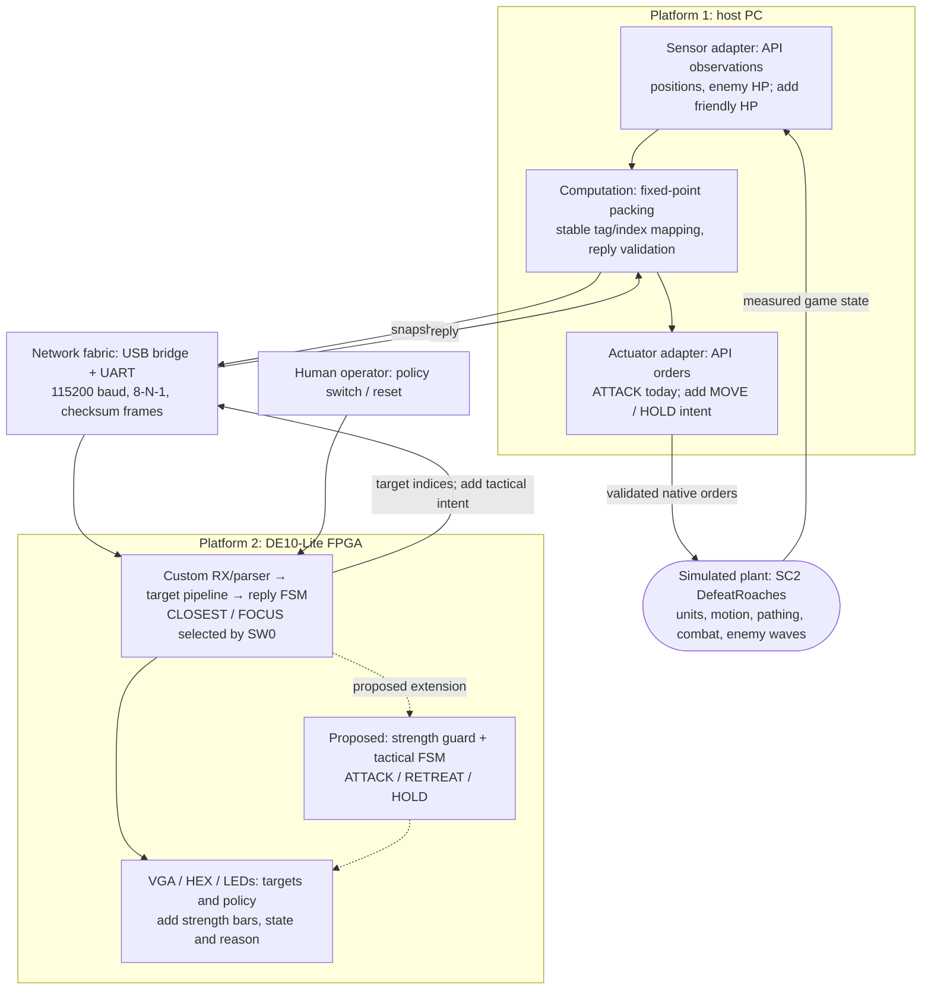

# Architecture: feedback control demonstrated in SC2

Updated November 12, 2026. The working implementation is
[PR #6](https://github.com/poroburu/eecs3216-fpga-sc2-tactics/pull/6) at
`7ce3b0e924949c3fc2966cbacd9eeae0be07a2f2`; this documentation branch does not
contain that implementation. The [proposal scope](proposal/scope.md) distinguishes
current functions from proposed additions.

## Adaptation of textbook Figure 1.1

Adapted conceptually from Lee and Seshia, *Introduction to Embedded Systems:
A Cyber-Physical Systems Approach*, second edition, version 2.3, Figure 1.1,
printed p. 6 ([author-hosted textbook](https://ptolemy.berkeley.edu/books/leeseshia/releases/LeeSeshia_DigitalV2_3.pdf)).
This is an original project diagram, not a reproduction of the textbook artwork.
The [standalone visual](proposal/architecture.html) presents the same feedback
loop for a presentation; the proposal PDF includes a compact version.

The API replaces physical sensing/actuation; **SC2 is a simulated plant**, not
real-world physics or a camera feed. The PC and FPGA form two computing
platforms connected by a network fabric. Orders change the game, which changes
the next observation: that closes the feedback loop. VGA is diagnostic output,
not the plant or the mechanism that controls the units.

| Textbook element | Project equivalent | Boundary |
|---|---|---|
| Physical plant | SC2 units, motion and combat simulation | Game engine handles pathfinding, collisions, cooldowns and actual damage. |
| Sensors | Legal visible-unit facts from the SC2 observation API | Host converts facts; no image recognition. |
| Computation on platform 1 | Host packing, ID mapping, validation, logs | No replacement friendly target policy; offline reference runs are labeled. |
| Network fabric | USB-to-UART bridge, GPIO RX/TX and framed packets | UART and host delays are measured separately from core cycles. |
| Computation on platform 2 | FPGA target-selection datapath and control FSMs | Proposed strength guard adds tactical state. |
| Actuators | SC2 action API calls mapped from FPGA results | Native attack currently includes movement into range and weapon execution. |
| Human interface | Physical switches/reset; VGA/HEX/LED outputs | Policy switch is sampled per computation. |

## Existing implementation in PR #6

- Marines versus Roaches in **DefeatRoaches**, 16 records/side maximum.
- Snapshot: ID, friendly x/y, enemy x/y/HP, squared reach; Q7.4 coordinates
  bounded at 2047, enemy HP 8 bits. Friendly HP/cooldowns are not transmitted.
- Reply: matching ID, status, policy, one target index per Marine and cycles.
- CLOSEST ranks `(d², index)`. FOCUS ranks in-range first, then HP for in-range
  units, then distance and index; all-out-of-range falls back to nearest.
- Three stages: coordinate differences → squares/sum → key/minimum selection.
  One pair per clock. Reported nonempty latency `F*E+2` cycles; max 258 at
  50 MHz. Test the cycle contract, not an old source comment's off-by-one value.
- Top-level transaction FSM: IDLE, COMPUTE, REPLY, ERROR; separate RX/TX/parser
  FSMs. Input is staged/validated and committed only when the core can accept it.
- Register records, not M9K RAM. Single 50 MHz clock domain; 25 MHz pixel enable,
  640×480 VGA, no PLL. Completed display records are held stable between updates;
  swaps are not explicitly restricted to vertical blank.
- Actual PR #6 inter-byte timeout is **10 ms**, not the old scaffold's 100 ms.
  Exact frames/pins are in that PR's `docs/protocol.md`; PR #5 has a different
  contract. Reconcile deliberately before integrating either branch.

The host issues `Attack(target)` only when a target changes or a Marine is idle.
SC2 can auto-target after a target dies until the next decision (eight loops,
about 0.36 game seconds), and handles the initial real-time loops. A failed link
causes no new host orders; old orders or native auto-targeting may continue.
Therefore the FPGA is not responsible for every individual shot.

## Proposed tactical extension

Keep the verified target pipeline. Add `PF=kF*F²`, `PE=kE*E²`, friendly-health
assessment, encounter/reset state and an ATTACK/RETREAT/HOLD tactical FSM.
Target policy is independent of tactical state. When ATTACK is permitted, use
CLOSEST or FOCUS; when retreat is latched, send MOVE toward the safe waypoint;
when arrived or empty, HOLD. The host translates these intents without choosing
the tactical state itself.

The complete proposed priority, numeric bounds, latch behavior and integration
gate are in [scope.md](proposal/scope.md#a-bounded-lanchester-implementation).
Any added fields require a versioned contract, independent fixtures and updated
host/RTL validation. Neither the extension nor a dedicated freeze/step UI is
present in PR #6. Prefer the existing clock domain and pixel enable; add a
frame-boundary display swap before promising tear-free presentation.
