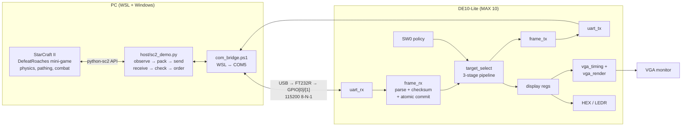
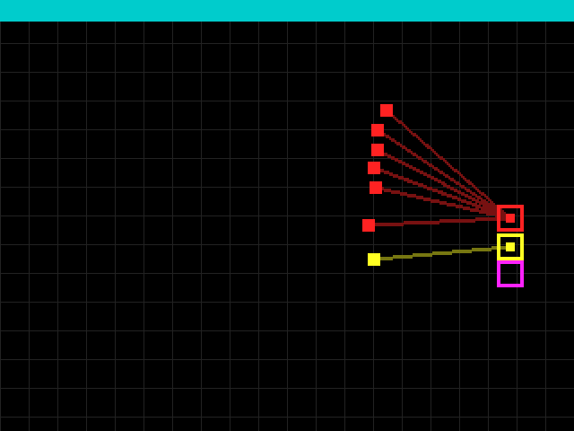
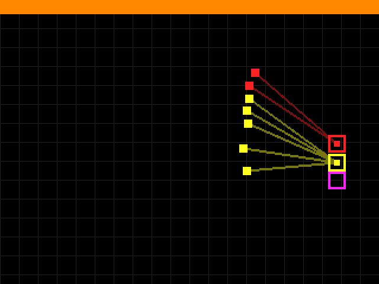
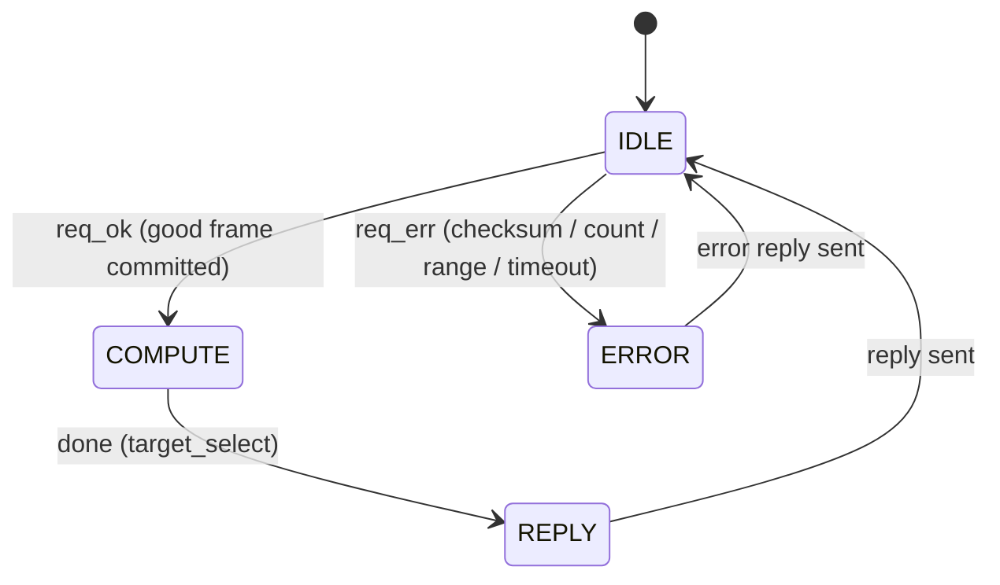

# How the demo works, end to end

Read this before the lab session. Every number here was measured on our board and
PC on November 8, 2026 (see [results.md](results.md)).

## One sentence

On every decision, StarCraft II tells the PC where the Marines and Roaches are. The PC
packs that into a UART frame. **The FPGA decides which Roach each Marine should shoot.**
The PC turns the FPGA's answer into SC2 attack orders.

## Who does what



| Part | Does | Does **not** |
|---|---|---|
| SC2 | Simulates the game: movement, pathing, weapon cooldowns, damage, rendering | Pick targets for our Marines |
| Host (Python) | Reads unit positions/HP, converts to fixed point, sends the frame, checks the reply (snapshot id, status, count, index range), issues `Attack(target)` only when a Marine's target changed | Choose targets. If the reply is bad, Marines get **no new orders** and the error is counted. There is no software fallback. |
| FPGA | Parses and validates the frame, computes every Marine's target, replies, draws its own view on VGA, shows diagnostics on HEX/LED | Talk to SC2, move units, or simulate combat |

## Walk through one decision

The snapshot below is the one in the VGA images: 7 Marines against 3 Roaches, mid-fight.

**1. Observe.** SC2 reports positions in map units, for example Marine 0 at (36.06, 29.00).
The host multiplies by 16 and rounds, giving Q.4 coordinates (577, 464). Reach is Marine
range + Marine radius + Roach radius = 5 + 0.375 + 0.5 = 5.875 map units. Times 16 that
is 94, so `reach2` = 94² = 8836.

**2. Send.** The request is 50 bytes:

```
a5 2a 07 03 22 84 | 02 41 01 d0 | 02 40 01 db | … 7 Marines … | 02 8c 01 bf 8c | 02 8c 01 af 79 | 02 8c 01 a0 91 | e7
sync snap nF nE reach2   M0 (577,464)   M1 (576,475)                R0 (652,447) hp140  R1 hp121       R2 hp145     chk
```

That takes 4.3 ms on the wire.

**3. Receive and validate (`frame_rx`).** A byte-level FSM steps through the fields
(SYNC → SNAP → NF → NE → R2H → R2L → FREC → EREC → CHK). Bytes go into **staging
registers** while a running sum builds the checksum. Only when `chk` matches and all
fields are legal does it copy everything into the **committed registers** in a single
clock and pulse `req_ok`. A corrupted frame can't leave half-updated data behind.

**4. Compute (`target_select`).** One (Marine, Roach) pair enters the pipeline per clock:

| Stage | Hardware | Marine 0 vs Roach 0 | vs Roach 1 | vs Roach 2 |
|---|---|---|---|---|
| S1 DIFF | two 12-bit signed subtractors | dx = −75, dy = 17 | −75, 33 | −75, 48 |
| S2 SQUARE | 2 embedded multipliers + adder | d2 = 5914 | 6714 | 7929 |
| S3 SELECT | range compare, key build, running min | in range, hp 140 | in range, hp 121 | in range, hp 145 |

S3 builds a 36-bit key by concatenating the fields. Comparing one 36-bit number
compares the fields in priority order:

```
key = { out_of_range (1) | hp or 0 (8) | d2 (23) | j (4) }
CLOSEST: {0, 0,   d2, j}  → smallest d2 → Roach 0 (5914)
FOCUS:   {0, hp,  d2, j}  → smallest hp among in-range → Roach 1 (121)
```

With 7 Marines × 3 Roaches = 21 pairs, plus a 2-clock pipeline drain, the compute takes
**23 clocks = 0.46 µs**.

**5. Reply (`frame_tx`).**

```
CLOSEST: 5a 2a 00 00 07 | 00 00 00 00 00 00 01 | 00 17 | 49     targets [0 0 0 0 0 0 1]
FOCUS:   5a 2a 00 01 07 | 01 01 01 01 00 00 01 | 00 17 | 4e     targets [1 1 1 1 0 0 1]
```

Under FOCUS, Marines 4 and 5 still get Roach 0. Their distance to Roach 1 squared is
9701 and 10537, which is more than 8836, so Roach 1 is out of their range. Roach 0 is
the only one they can actually hit.

**6. Act.** The host maps index → SC2 unit and sends `Attack` only when a Marine's target
changed. SC2 then advances 8 game loops (0.36 s of game time) and the cycle repeats.

**7. Display.** The lines need no divider or square root. A pixel P is on the line from
Marine F to target T when it is inside their bounding box and |(P−F)×(T−F)| ≤ max(|dx|,|dy|).
That is two multiplies per line, so 32 multipliers for 16 lines, in a 4-stage renderer
pipeline. When the result is final, the top FSM copies positions and targets into
**display registers**. The VGA renderer reads only those, so the picture always shows
one consistent snapshot. Everything runs in the single 50 MHz clock domain (VGA uses a
25 MHz pixel *enable*), so no clock-domain crossing is needed.

| CLOSEST (`SW0` down) | FOCUS (`SW0` up) |
|---|---|
|  |  |

These are simulated frames, captured from the `VGA_R/G/B` pins by `sim/tb_vga_frame.sv`.
Each Roach (hollow square) has its own colour. Each Marine (small square) takes the colour
of the Roach it shoots, and a half-brightness line joins the two. A filled centre marks a
Roach that someone is targeting.
The banner shows the policy: cyan for CLOSEST, orange for FOCUS, red after an error.

## What crosses the UART, what is fixed, and what bypasses the FPGA

**To the FPGA:** Marine x/y, Roach x/y/HP, `reach2`, and a snapshot id.
**Not sent:** Marine HP, cooldowns, unit types, terrain. The two rules do not use them.
**From the FPGA:** one Roach index per Marine, the policy used, a status code, and the
cycle count. The FPGA returns targets only; moving, retreating and holding are not part
of this demo.

The only command the host ever sends to SC2 is `Attack(<the Roach the FPGA chose>)`
(`host/sc2_demo.py`, a single call). It sends it only when that Marine's target changed
or the Marine is idle.

| Hard-coded | Where | Effect |
|---|---|---|
| The two rules (closest; weakest in range) | FPGA, selected by `SW0` | This is the design; changing a rule means changing the HDL |
| DefeatRoaches map, playing as Terran | host | Unit counts, positions and HP are always read live from SC2 |
| Decision every 8 game loops (0.36 s) | host `--step` | How often the FPGA is asked |
| Q.4 scale (×16), at most 16 units per side | host and FPGA | Protocol limit; DefeatRoaches never exceeded 10 vs 4 |
| Reach from the first Marine's and first Roach's stats | host | Correct only because each side is a single unit type |
| VGA view centred on the DefeatRoaches arena | `vga_render.sv` | Units on other maps may fall outside the view |
| Seed 1 by default | `tools/demo.sh` | Makes step-mode games repeatable; real-time games still vary |

| Not decided by the FPGA | Who | When |
|---|---|---|
| Walking into range, pathing, firing, damage | SC2 engine | Always: the FPGA picks the target, SC2 executes the attack |
| **Idle auto-targeting** | SC2 built-in unit behaviour | When a Marine's target dies, SC2 lets it shoot any enemy in range until our next decision (≤ 8 loops = 0.36 s) replaces that choice |
| The first loops of a real-time game | SC2 | The first decision arrived at loop 12 |
| Not re-sending an unchanged target | host | Removes duplicate commands only; the target is still the FPGA's |
| After a link error | SC2 | No orders that step; Marines keep their last order or auto-target. 0 link errors so far |
| Roaches, new waves, score | SC2 and the map script | We do not control the enemy |

Lowering `--step` to 2 would shrink the auto-targeting window to 0.09 s, at about four
times the UART traffic. That is a possible improvement; the demo runs have used 8.

## Control FSM (top level)



`frame_rx` keeps listening in every state. It commits only while the top FSM is in IDLE,
which is how the input registers are protected during a computation.

## Board controls

| Control | Function |
|---|---|
| `SW0` | Policy: down = CLOSEST, up = FOCUS. Read at the start of each computation and echoed in the reply. |
| `SW4..SW1` | Pick Marine k: `HEX1` shows k, `HEX0` shows its target (`-` = none) |
| `KEY0` | Reset |
| `KEY1` | Clear the sticky error/overrun LEDs |
| `HEX5:4` | Snapshot id (hex). It counts up while the game runs. |
| `HEX3` | `C` or `F` (policy used for the shown result) |
| `HEX2` | Last status code (0 = OK) |
| `LEDR0` | `SW0` |
| `LEDR1` | A frame is being received |
| `LEDR2` | Sticky error |
| `LEDR3` | Sticky overrun |
| `LEDR9..4` | Bar graph of how many *different* Roaches are being targeted. FOCUS keeps it short. |

## Why the hardware is "correct", not just "plausible"

The specification ([protocol.md](protocol.md)) gives exactly one right answer for every
input. Correctness is therefore checked by a byte-for-byte match against an independent
Python reference. That reference is written with tuples, not the HDL's concatenation
trick, so a mistake in either one shows up as a mismatch.

| Check | Where | Cases | Result |
|---|---|---|---|
| Directed: ties, empty, exact range boundary, max coordinates, 16×16, every error code, recovery | Verilator, through the UART pins | 34 | all pass |
| Real SC2 snapshots × both policies | Verilator | 182 | all pass |
| Random frames: clustered positions, HP ties, random reach | Verilator | 1,000 | all pass |
| Same 1,216 cases over the real USB-UART to the board | `host/hw_check.py` | 1,216 | all pass (`SW0` = CLOSEST) |
| Live games, board vs software, seeds 1–10 | `sc2_demo.py` | 10 games | every game identical (score, length, orders) |
| Testbench catches a deliberately corrupted expected byte | mutation check | 1 | detected |

## Questions to be ready for

- **"Is the PC choosing targets?"** No. Run `tools/demo.sh check`, then flip `SW0` during
  a game: the behaviour changes and `HEX3` changes, with no software change. If no valid
  reply arrives, `sc2_demo.py` issues no orders for that step and counts a link error.
  It has no targeting logic of its own to fall back on.
- **"Why an FPGA if Python takes microseconds?"** The goal is a verified hardware
  implementation of a fully specified function: UART, framing, a pipelined datapath,
  control FSMs, and video, all in one clock domain. The FPGA compute is 5.16 µs worst
  case. The 13–17 ms round trip is almost all UART and USB time, and we say so.
- **"Does FOCUS win more?"** In step mode, on the same 10 seeds, the reference shows FOCUS
  averaging 62.4 against CLOSEST's 32.1. The board reproduced CLOSEST game for game.
  This is a measured outcome on one scenario, not a general claim.
- **"What if a frame is corrupted?"** `hw_check` sends bad checksums, bad counts,
  out-of-range coordinates, and truncated frames. Each gets the right error code, and
  the next good frame works.
